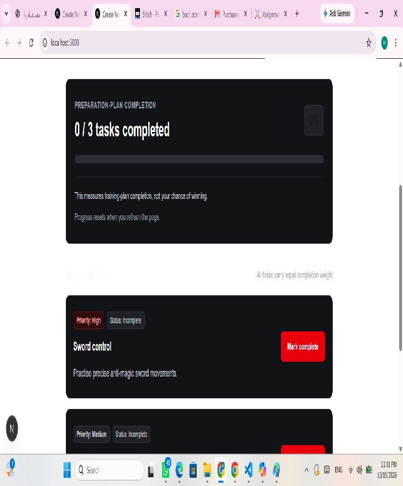
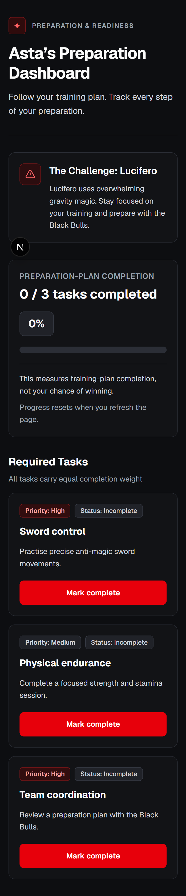

# Asta’s Preparation Dashboard

**Author:** Hiba Hussieni  
**TechTalks — Assignment 2**  
**Branch:** `assignment-2-asta-mvp`

A responsive dashboard that helps Asta follow three predefined training tasks, complete or undo them, and track preparation-plan completion.

## Preview

### Desktop



### Mobile



## Features

1. View training tasks with descriptions and priorities.
2. Mark tasks complete and undo completion.
3. View a calculated completed/total count and percentage.

Training tasks:

- Sword control
- Physical endurance
- Team coordination

All tasks contribute equally to progress. The percentage measures plan completion, not the chance of winning.

## Stack

- Next.js with App Router
- React
- TypeScript
- Tailwind CSS

## Installation

Install Node.js compatible with the project's Next.js version. This project was developed using Node.js 24.

From the repository folder, run:

```bash
npm ci
npm run dev
```

Open the local URL printed in the terminal, normally:

http://localhost:3000

On Windows PowerShell, if `npm.ps1` is blocked, use:

```powershell
npm.cmd ci
npm.cmd run dev
```

## Checks and Production Build

Run the checks and create a production build:

```bash
npm run lint
npm run build
```

Start the production server:

```bash
npm start
```

The production server requires a successful build first.

## State and Progress

Each task has a completion boolean. The completed count and percentage are derived from the current task states.

```text
percentage = Math.round((completedCount / totalTasks) * 100)
```

Expected values:

- 0 / 3: 0%
- 1 / 3: 33%
- 2 / 3: 67%
- 3 / 3: 100%

Progress is held in React state and resets when the page refreshes. No database or browser persistence is used.

## Project Files

- `app/page.tsx`: dashboard title and threat brief.
- `app/TrainingDashboard.tsx`: interactive tasks and progress.
- `app/globals.css`: global styling.
- `app/TrainingPoc.tsx`: retained minimal experiment; not rendered by the final dashboard.
- `docs/evidence/`: screenshots and supporting evidence.

The POC is also preserved in Git history:

`f6e1431` — Test training progress proof of concept.

## Documentation

- [Product requirements](docs/PRD.md)
- [Design decisions and refinement](docs/DESIGN.md)
- [MCP connection and actual results](docs/MCP.md)
- [POC approach and manual results](docs/POC.md)
- [Engineering review and remaining work](docs/REVIEW.md)
- [Screenshots](docs/evidence/)

## Design and MCP

The dashboard was designed in Google Stitch for desktop and mobile.

A refinement removed an unnecessary design-specification section and its disabled demonstration button.

VS Code's MCP client connected to the Stitch server. Successful calls returned project information and desktop screen details. The returned HTML URL was fetched separately to check the refined content.

See `docs/MCP.md` for tool names and results. Design screenshots and implementation screenshots are available in `docs/evidence/`.

## Verification

The following results were recorded during project verification:

- ESLint completed successfully with exit code 0.
- Production build and TypeScript checks completed successfully.
- Manual completion, undo, repeated-toggle, and refresh checks passed.
- Keyboard activation and visible focus were checked manually.
- The layout was checked on desktop and at 360px wide.
- I compared the desktop implementation with the selected design and found it closely matched.

No automated browser test suite was run.

A usability session was completed with my sister. She reported that the interface was clear and that the percentage matched task completion.

## Dependency Audit

At the time of verification:

- `npm audit --omit=dev`: zero reported vulnerabilities.
- Full `npm audit`: five high-severity findings in the ESLint development dependency chain.

The suggested forced fix would downgrade `eslint-config-next` to version 14.2.35. It was not applied because it introduces a breaking change to the Next.js 16 setup.

These development dependency findings remain unresolved. Audit results reflect the verification date and have not been rechecked for this README update.

## Scope and Limitations

- Exactly three predefined tasks.
- One dashboard screen.
- No login, database, task editing, payments, chatbot, combat simulation, or live anime data.
- Progress resets after refresh.
- User feedback is limited to one participant.
- Screen-reader behaviour and measured color contrast have not been verified.

## Credits

Educational project inspired by Black Clover, created by Yuki Tabata.

The training tasks and dashboard scenario were supplied by TechTalks. This is an unofficial educational application.
